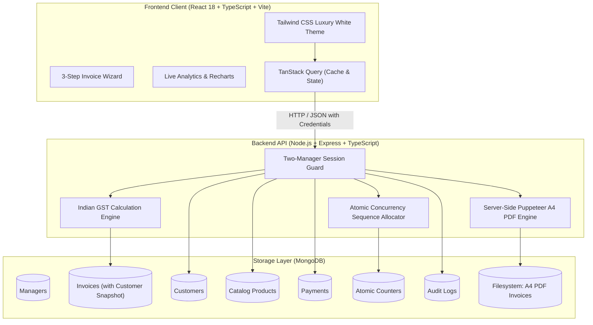

# SHREE SHAKTI BILLING — Architecture Document

## 1. System Overview

**SHREE SHAKTI BILLING** is an enterprise-quality full-stack billing and management software suite custom-built for **Shree Shakti Electric** (Rajkot, Gujarat). The application replaces single-user local billing prototypes with a multi-client central server architecture supporting two authorized managers (Hiren and Suresh) working independently or simultaneously across local area networks (LAN) or cloud deployments.

---

## 2. Key Architectural Decisions

### 2.1 Two-Manager Strict Authentication Model
- Public self-registration is permanently disabled.
- Exactly two manager profiles exist: `hiren` (signatory: `hiren.png`) and `suresh` (signatory: `suresh.png`).
- Authentication uses salted **Argon2id/Bcrypt** hashes.
- Server-side sessions are persisted in MongoDB via `connect-mongo`, with `HttpOnly`, `SameSite`, and `Secure` cookie flags.
- Manager identity on all invoices, payments, and audit logs is strictly derived from the validated server session—never trusted from client payloads.

### 2.2 Concurrency-Safe Invoice Sequencing
- Format: `SE-yyMM-XXX` (e.g. `SE-2611-001`, `SE-2611-002`).
- Generated through an atomic MongoDB `Counter.findOneAndUpdate({ _id: key }, { $inc: { seq: 1 } })`.
- Even when Hiren and Suresh submit invoices in the exact same millisecond, each invoice receives a guaranteed unique, non-colliding sequential identifier.
- Editing an existing invoice strictly preserves its original sequence number and historical ID.

### 2.3 Indian GST & Billing Engine
- Decimal precision maintained through integer paise arithmetic (`roundToPaise`), preventing floating-point precision errors (e.g., `0.1 + 0.2 = 0.30000000000000004`).
- Supports both Intra-State (CGST + SGST split 50/50) and Inter-State (IGST 100%) transactions.
- Zero-tax, exempt items, item-level discounts (% or flat amounts), round-off to nearest rupee, and Indian currency word generation ("Rupees Five Thousand Four Hundred Only").

### 2.4 Server-Side A4 PDF Generation
- Uses HTML/CSS print templates rendered via Puppeteer.
- Incorporates authentic business branding:
  - Header: SHREE SHAKTI ELECTRIC, specialization tagline, contact phone numbers.
  - Two-column billing and invoice metadata.
  - Bordered items table with vertical rule lines extending the entire printable height.
  - Amount in words, payment instructions, terms & conditions.
  - Authorized signatory block mapping authentic signature PNG assets (`hiren.png` / `suresh.png`).
- Stored on filesystem in `server/storage/pdfs/` and served via streaming endpoint with caching.

---

## 3. Deployment Topologies

1. **Standalone Host Machine**: Both server and local client run on the main office PC.
2. **Local Area Network (LAN) Central Server**: The backend and MongoDB run on the primary office server (`0.0.0.0:5000`). Manager 1 uses `http://localhost:5173` and Manager 2 uses `http://<SERVER_LAN_IP>:5173`.
3. **Cloud Production**: Containerized deployment with managed MongoDB Atlas, Cloudflare SSL termination, and automated backups.
